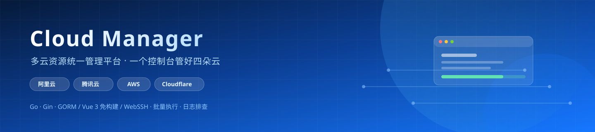
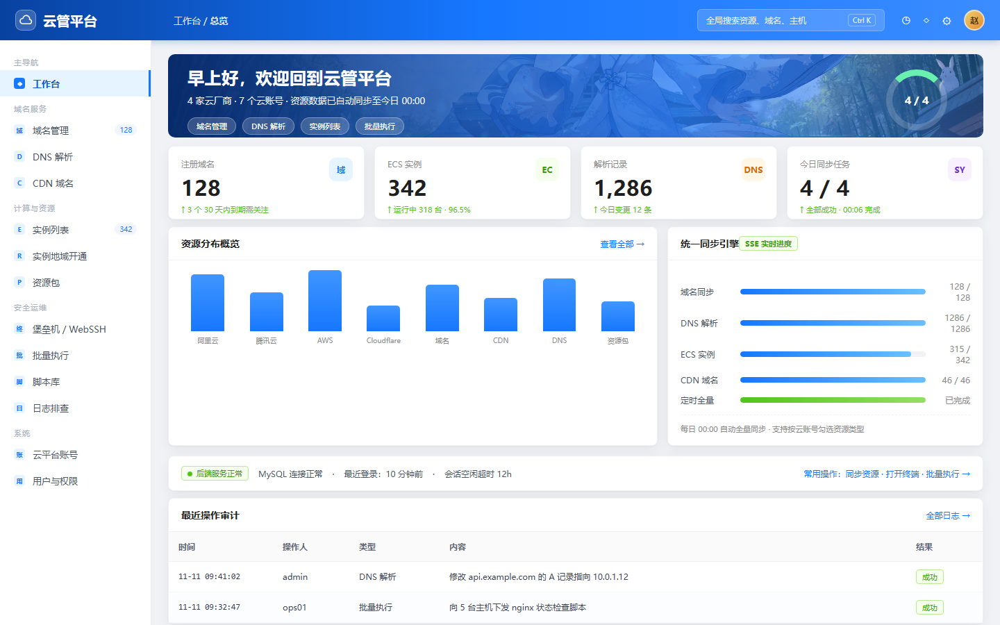
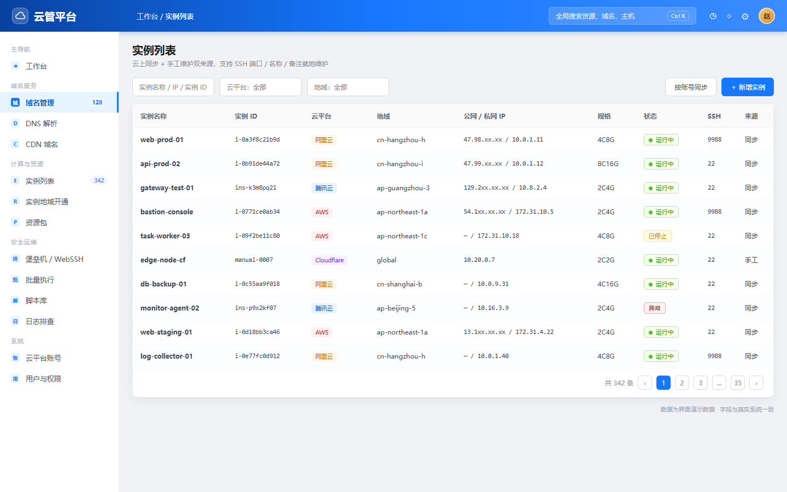
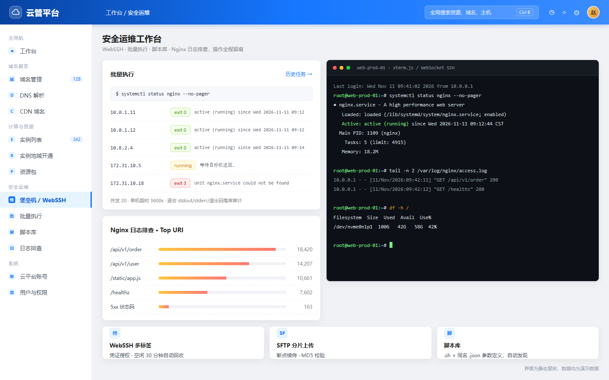
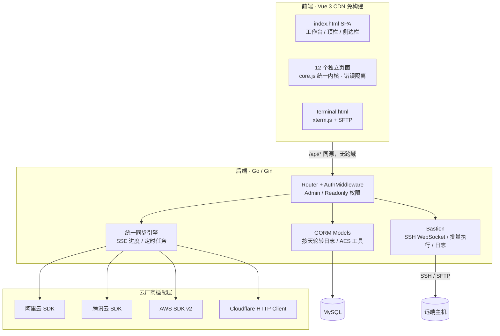

<div align="center">



# Cloud Manager · 多云资源统一管理平台

**一套后端直托前端的轻量云管平台：把分散在 4 家云厂商的域名、DNS、ECS、CDN 与日常运维操作，收进同一个控制台。**


[交互式展示页](docs/index.html)（启用 GitHub Pages 后可直接访问） · [快速开始](#快速开始) · [功能矩阵](#功能矩阵) · [架构](#架构设计)

</div>

---

## 一眼看懂

| | | | |
|:---:|:---:|:---:|:---:|
| **4** 家云厂商统一纳管 | **12+** 业务页面 | **16+** 功能模块 | **3 万+** 行代码 |
| 阿里云 / 腾讯云 / AWS / Cloudflare | 免构建 Vue 3 前端 | 从资源台账到堡垒机 | Go + 前端全栈独立开发 |

> 不是「又一个云厂商控制台的复制品」：它把**多云资源台账**、**堡垒机/WebSSH**、**批量执行**和**日志排查**串成一条运维动线，AccessKey 加密托管、操作全程留痕。

---

## 界面预览

> 下列界面图由仓库内的 `docs/preview.html` 高保真复刻并自动截图生成，无需启动服务即可查看；数据均为演示数据。

### 工作台



### 资源台账（ECS / 域名 / DNS）



### 运维工作台（Web 终端 / 批量执行 / 日志排查）



<details>
<summary>想看更真实的效果？</summary>

界面图为静态复刻，本地跑起来后可自行截图替换 `docs/screenshots/*.png`（保持文件名即可，README 无需改动）：

```bash
# 后端起来后浏览器打开 http://localhost:8080
cd cloud-manager-backend && ./devops
```

</details>

---

## 功能矩阵

| 域 | 能力 | 说明 |
| --- | --- | --- |
| **多云账号** | AccessKey 托管 | AES 加密存储、Secret 脱敏展示、按账号勾选资源类型同步 |
| **统一同步** | 一键全量 / 定时 | 域名、DNS、ECS、CDN 统一同步引擎，**SSE 实时进度**，每日 0 点自动全量 |
| **域名** | 生命周期监控 | 四平台注册域名汇总、到期 30 天/过期漏斗、详情与备注 |
| **DNS** | 记录 CRUD | 增删改查/启停、TTL 与负载策略；针对阿里云重复限制做「先查后比、删+增」智能修改 |
| **CDN** | 加速域名快照 | 阿里云 CDN / DCDN、AWS CloudFront 的 CNAME、源站、HTTPS 状态 |
| **ECS** | 实例台账 | 云同步 + 手工维护双来源、后端分页多维筛选、SSH 端口/名称/备注就地维护 |
| **地域 / 资源包** | 开通与成本 | 三平台地域启停、按账号 region_mode；阿里云资源包实时汇总（不落库） |
| **权限** | RBAC | admin / user / readonly 三角色，验证码 + IP 限流、失败锁定、个人资料与改密 |
| **堡垒机** | WebSSH + SFTP | xterm.js 多标签终端、分片上传/断点续传、凭证与用户组授权、空闲会话回收 |
| **批量执行** | 并发下发 | sh/bash/python3 脚本并发执行、单机超时与取消、逐台 stdout/stderr/退出码落库审计 |
| **脚本库** | 约定式发现 | `.sh` + 同名 `.json` 参数定义，上传/预览/删除 |
| **日志排查** | Nginx 分析 | 日志路径探查 + awk 聚合分析，`go:embed` 脚本按 md5 同步到目标机 |

---

## 架构设计



**几个刻意的设计取舍**

- **前端零构建**：Vue 3 生产库本地引入，每个业务页面 = 一个独立 HTML + 一个独立 JS，单页报错不会让全站白屏；后端 Gin 直接托管静态目录，`/api/*` 同源无跨域。
- **同步引擎统一抽象**：`Provider` 接口 + 四家适配层，新增云厂商只需实现接口；Cloudflare 作为 DNS 特例跳过 ECS/域名/CDN 同步。
- **配置与密钥外置**：`config.yaml` 不入库，`AES_SECRET_KEY` 走环境变量，云账号 Secret 加密后只回显脱敏值。
- **堡垒机可选启用**：`bastion.enabled=false` 时相关路由与菜单整体不挂载，缩小攻击面。

---

## 技术栈

| 层 | 选型 |
| --- | --- |
| 后端 | Go 1.26 · Gin · GORM + MySQL · Viper · gorilla/websocket · pkg/sftp · base64Captcha |
| 云 SDK | 阿里云 OpenAPI / Darabonba · 腾讯云 DNSPod & Domain · AWS SDK v2（EC2 / Route53 / CloudFront / STS）· Cloudflare REST |
| 前端 | Vue 3（本地 CDN 化）· 原生 CSS（Ant Design 风格亮色控制台，主色 `#1677ff`）· xterm.js · Font Awesome |
| 部署 | `go build` 单二进制 + systemd + Nginx 静态托管/反代（含 WebSocket、SSE、SFTP 规则） |

---

## 快速开始

> 两个目录需同级放在 `cloud-manager/` 下，进程工作目录必须是 `cloud-manager-backend/`。

```bash
# 1. 数据库
mysql -e "CREATE DATABASE cloud_manager DEFAULT CHARACTER SET utf8mb4;"

# 2. 配置
cd cloud-manager-backend
cp config.example.yaml config.yaml      # 至少改 database.mysql 的 host/user/password
export AES_SECRET_KEY='<32-byte-random-key>'

# 3. 构建 / 初始化 / 启动
go build -o devops .
./devops init                            # 幂等：建表 + 种子数据 + 管理员
./devops                                 # 监听 :8080
```

浏览器打开 `http://localhost:8080`。前端由后端托管，**不能单独用 live-server 启动**（会跨域）。前端 CDN 字体/图标/xterm 需要外网，离线时功能降级。

生产部署参考 `cloud-manager-front/deploy/nginx.conf` 与 `cloud-manager-backend/deploy/cloud-manager.service`。

---

## 目录结构

```text
cloud-manager/
├── README.md                  ← 你正在看
├── docs/                      ← 展示页、界面图、设计素材
│   ├── index.html             # GitHub Pages 展示页
│   ├── preview.html           # 界面高保真复刻（截图源）
│   └── screenshots/           # 自动生成的界面图
├── cloud-manager-backend/     # Go / Gin 服务（111 个 .go 文件）
│   ├── main.go                # 配置、定时同步、优雅关闭
│   ├── internal/router/       # 路由与中间件
│   ├── internal/login/        # 登录、验证码、限流、鉴权
│   ├── internal/pkg/cloud/    # 四家云厂商适配 + 同步引擎 + 堡垒机
│   ├── internal/models/       # GORM 模型与同步落库
│   └── scripts/               # init_db.sql、go:embed 运维脚本
└── cloud-manager-front/       # Vue 3 免构建前端
    ├── index.html             # SPA 主站
    ├── terminal.html          # WebSSH / SFTP
    ├── assets/pages/          # 12 个独立业务页面
    └── assets/js/             # app.js / core.js / pages/*.js
```

更细的接口与字段说明见 `cloud-manager-backend/README.md`、`cloud-manager-front/README.md` 与各自的 `PROJECT.md`（**代码是唯一真相源**）。

---

## 面试看点

1. **全栈独立交付**：从 GORM 模型、云 SDK 适配、SSE 同步引擎到 12 个前端页面与权限体系，一个人完成设计与实现。
2. **多云抽象能力**：`Provider` 接口统一四家差异巨大的 API，并处理各家特例（Cloudflare 只做 DNS、阿里云 DNS 重复记录限制）。
3. **实时与并发**：SSE 同步进度、WebSocket WebSSH、批量执行并发控制 + 单机超时/取消 + 结果审计。
4. **安全设计**：AK 加密存储与脱敏回显、三角色 RBAC、验证码 + IP 限流 + 失败锁定、会话空闲超时。
5. **工程化取舍**：免构建前端降低部署复杂度、独立页面错误隔离、`go:embed` 脚本分发、按天轮转日志。

---

## 说明

- 本项目为个人技术作品，用于能力展示；仓库内**不含任何真实云账号、密钥或生产数据**，配置均为 `config.example.yaml` 占位值。
- 截图为静态复刻的演示数据，非生产环境实录。
- 欢迎提 Issue 交流，暂不接受生产环境支持请求。
